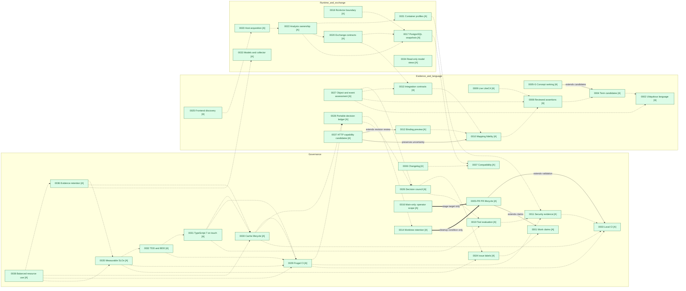

# Architecture decision ledger

This is the navigation index for the MADRs in this checkout. A record's declared
status and scope are authoritative; implementation, merge or operator-local
adoption does not make a proposal accepted repository-wide. See the accepted
[evidence-based council process](0026-evidence-based-decision-councils.md).
On **2026-11-09**, the user explicitly approved **all 37 proposed/pending MADRs
on current main** at `9767bbcb7249375574b2306596389f7ccaa3a2a2`.
The [approval and scope acknowledgement](https://github.com/Sonberg/capability-explorer/issues/3#issuecomment-6742261485)
accepts each decision method/design within its stated scope and qualifications.
It is an explicit operator authority decision, not an evidence-clean council
verdict or proof of implementation, measured SLOs, approved retention durations,
real-source access, business assertions, deletion authority or experimental-tool
activation. Each record preserves its previous status and historical rationale;
separate implementation approvals and operational exceptions remain in force.

## Status ledger and legend

| Diagram color | Text label | Meaning |
|---|---|---|
| Green | A: accepted | Explicitly accepted within the record's stated scope, not implementation/release certification. |
| Yellow | P: proposed/pending | Review or evidence still needed, including locally applied/operator-authorized proposals. |
| Red | D: draft | Not yet ready for decision review; not a severity rating. |
| Gray | H: historical | Rejected, deprecated or superseded; retain the decision and replacement links. |

There are **38 local records: 38 scoped accepted (37 newly accepted plus
1 previously accepted), 0 proposed, 0 draft, 0 historical**.
MADR-0016's prior acceptance for the **operator workflow only** is unchanged.
Both `0005` paths are distinct records, named `0005-G` and `0005-PR` below solely
for navigation. No `0015` exists; this is a numbering gap, not a missing file
invented by the index. MADR-0035 covers measurable SLOs, MADR-0036 covers
configurable evidence retention, MADR-0037 covers HTTP recommendations, and
MADR-0038 covers balanced RAM and disk use.
MADR-0025 landed in owner-merged #55; decision acceptance now comes from the
2026-11-09 approval, not that merge. Its implementation qualifications remain.

| ID | Title / record | Declared status and scope |
|---|---|---|
| 0001 | [GitHub work claims and isolated queen–worker delivery](0001-github-work-coordination.md) | A: decision policy/design for GitHub work claims and isolated queen–worker delivery; within the stated outcome and qualifications |
| 0002 | [Establish and govern a shared ubiquitous language](0002-ubiquitous-language.md) | A: decision policy/design for Establish and govern a shared ubiquitous language; within the stated outcome and qualifications |
| 0003 | [Run project-wide build and vulnerability gates locally before push](0003-local-ci-before-push.md) | A: decision policy/design for Run project-wide build and vulnerability gates locally before push; within the stated outcome and qualifications |
| 0004 | [Treat glossary groups as deterministic term candidates](0004-glossary-candidates.md) | A: decision policy/design for Treat glossary groups as deterministic term candidates; within the stated outcome and qualifications |
| 0005-G | [Rank glossary candidates into domain concepts with an explainable score](0005-glossary-concepts.md) | A: decision policy/design for Rank glossary candidates into domain concepts with an explainable score; within the stated outcome and qualifications |
| 0005-PR | [Coordinate PR updates and preserve review context](0005-pr-lifecycle-and-conflict-prevention.md) | A: decision policy/design for Coordinate PR updates and preserve review context; within the stated outcome and qualifications |
| 0006 | [Maintain a curated project changelog](0006-keep-a-changelog.md) | A: decision policy/design for Maintain a curated project changelog; within the stated outcome and qualifications |
| 0007 | [Version the product against an explicit compatibility contract](0007-semantic-versioning.md) | A: decision policy/design for Version the product against an explicit compatibility contract; within the stated outcome and qualifications |
| 0008 | [Separate evidence navigation from reviewed glossary assertions](0008-glossary-flow-and-reviewed-assertions.md) | A: decision policy/design for Separate evidence navigation from reviewed glossary assertions; within the stated outcome and qualifications |
| 0009 | [Share a live LikeC4 canvas without changing evidence semantics](0009-live-likec4-architecture.md) | A: decision policy/design for Share a live LikeC4 canvas without changing evidence semantics; within the stated outcome and qualifications |
| 0010 | [Preserve uncertainty while improving deterministic repository mappings](0010-deterministic-mapping-fidelity.md) | A: decision policy/design for Preserve uncertainty while improving deterministic repository mappings; within the stated outcome and qualifications |
| 0011 | [Source-bound security validation with explicit unresolved findings](0011-source-bound-security-validation.md) | A: decision policy/design for Source-bound security validation with explicit unresolved findings; within the stated outcome and qualifications |
| 0012 | [Revision-bound binding preview and explicit export](0012-revision-bound-binding-preview.md) | A: decision policy/design for Revision-bound binding preview and explicit export; within the stated outcome and qualifications |
| 0013 | [Versioned integration contracts as evidence, separate from inference](0013-integration-contract-standards.md) | A: versioned integration evidence decision; extractor implementation requires separate authorization |
| 0014 | [Remove recoverable worktrees after PR publication](0014-pr-publication-worktree-retention.md) | A: decision policy/design for Remove recoverable worktrees after PR publication; within the stated outcome and qualifications |
| 0016 | [Merge PRs only into main and reconcile the existing stage history](0016-main-only-pr-integration.md) | A: operator workflow accepted by explicit directive; implementation subject to owner review |
| 0017 | [PostgreSQL snapshots and bounded Explorer reads](0017-postgres-explorer-snapshots.md) | A: decision policy/design for PostgreSQL snapshots and bounded Explorer reads; within the stated outcome and qualifications |
| 0018 | [Evaluate RuVector separately from canonical fact storage](0018-ruvector-evaluation-boundary.md) | A: RuVector evaluation boundary only; extension adoption requires a separate owner decision |
| 0019 | [Evaluate tools independently before introducing dependencies](0019-independent-tool-evaluation.md) | A: decision policy/design for Evaluate tools independently before introducing dependencies; within the stated outcome and qualifications |
| 0020 | [Draft evidence-platform exchange contracts, separate from extractor facts](0020-platform-exchange-contracts.md) | A: evidence-platform exchange design and first shape-contract package only |
| 0021 | [Explicit container engine and qualified execution profiles](0021-explicit-container-engine-core.md) | A: decision policy/design for MADR-0021: Explicit container engine and qualified execution profiles; within the stated outcome and qualifications |
| 0022 | [Single-host analysis ownership and publication](0022-local-analysis-lifecycle.md) | A: decision policy/design for MADR-0022: Single-host analysis ownership and publication; within the stated outcome and qualifications |
| 0023 | [Host-owned source checks and acquisition credentials](0023-host-acquisition-boundary.md) | A: decision policy/design for MADR-0023: Host-owned source checks and acquisition credentials; within the stated outcome and qualifications |
| 0024 | [Issue labels and explicit delivery dependencies](0024-issue-labels-and-dependencies.md) | A: decision policy/design for Issue labels and explicit delivery dependencies; within the stated outcome and qualifications |
| 0025 | [Language-neutral frontend contract and deterministic unit discovery](0025-language-neutral-frontends-and-discovery.md) | A: language-neutral frontend decision direction; adjacent research drafts are not adopted runtime contracts |
| 0026 | [Evidence-based decision councils and a navigable MADR ledger](0026-evidence-based-decision-councils.md) | A: decision policy/design for Evidence-based decision councils and a navigable MADR ledger; within the stated outcome and qualifications |
| 0027 | [Proposed source-bound assessment of business objects and events](0027-domain-object-event-assessment.md) | A: research model and synthetic contract only; no extractor, grader, schema/v1 change, or production classification |
| 0028 | [Portable, source-bound decision navigation](0028-portable-decision-ledger.md) | A: bounded decision-ledger contract, synthetic portability and repository inventory |
| 0029 | [Frugal CI with executable local and hosted parity](0029-frugal-ci-and-executable-parity.md) | A: decision policy/design for Frugal CI with executable local and hosted parity; within the stated outcome and qualifications |
| 0030 | [Govern dependency caches across framework and toolchain upgrades](0030-dependency-cache-lifecycle.md) | A: decision policy/design for Govern dependency caches across framework and toolchain upgrades; within the stated outcome and qualifications |
| 0031 | [Convert maintained JavaScript to TypeScript 7 when modified](0031-typescript7-on-touch.md) | A: repository-wide TypeScript-on-touch decision policy; no compiler upgrade or enforcement established |
| 0032 | [Drive implementation with behavior scenarios and red-green-refactor tests](0032-tdd-bdd-delivery.md) | A: repository-wide TDD/BDD decision policy; no new framework mandated or feature-test evidence established |
| 0033 | [Keep authored models, code candidates and collector authority separate](0033-bounded-model-and-collector-evidence.md) | A: bounded evidence profiles and offline collection; no central deployment, real-source access or business approval |
| 0034 | [View revision-bound original models without granting execution authority](0034-revision-bound-read-only-model-views.md) | A: revision-bound read-only model-view decision; no execution authority or business approval |
| 0035 | [Require measurable objectives for performance and operational-quality issues](0035-measurable-service-level-objectives.md) | A: repository-wide SLO decision policy; workload targets and compliance require separate evidence |
| 0036 | [Configure evidence retention and age-based historical resolution](0036-configurable-evidence-retention.md) | A: configurable retention design; numeric durations, custody and enforcement require separate approval |
| 0037 | [Recommend HTTP capabilities from observed route coverage without adopting bindings](0037-http-capability-recommendations.md) | A: bounded HTTP recommendation and explicit revision-bound review; no binding adoption |
| 0038 | [Balance RAM and disk use with performance and developer productivity](0038-balanced-resource-use.md) | A: resource-use decision method; no budget enforcement, monitoring or cleanup implemented |

## Relationship map

All local records appear below; labels are abbreviated for readability and the
table provides full titles and links. The graph deliberately shows **selected,
source-declared relationships**, not every reference or an inferred task DAG.
Cycles among related decisions are not evidence of circular hard prerequisites.
An isolated node means no selected edge, not proof of independence.

- `X --> Y`: X extends or explicitly follows Y's rules; label states which.
- `X -.-> Y`: X references/relates to Y; **not** a hard dependency.
- `X ==> Y`: X overrides a stated part of Y; **not** whole-record supersession.

No draft or historical nodes are fabricated to populate the legend.

### Edge evidence ledger

Each row covers exactly the listed graph edges. Direction is from the
referencing/extending/overriding record to its target.

| From | To | Type and source passage |
|---|---|---|
| 0005-PR | 0001, 0003 | Extends: [Decision outcome](0005-pr-lifecycle-and-conflict-prevention.md#decision-outcome) explicitly extends claims and validation. |
| 0014 | 0005-PR | Scoped override: [Decision outcome](0014-pr-publication-worktree-retention.md#decision-outcome), merged-only cleanup condition, not the entire lifecycle. |
| 0016 | 0005-PR | Scoped override: [Context](0016-main-only-pr-integration.md#context-and-problem-statement), stage-only target direction. |
| 0006 | 0007 | Related metadata in [record](0006-keep-a-changelog.md). |
| 0011 | 0003 | Related metadata in [record](0011-source-bound-security-validation.md). |
| 0019 | 0011 | Related metadata in [record](0019-independent-tool-evaluation.md). |
| 0024 | 0001 | Related metadata in [record](0024-issue-labels-and-dependencies.md). |
| 0026 | 0019, 0024 | Related metadata in [record](0026-evidence-based-decision-councils.md). |
| 0004 | 0002 | Related metadata in [record](0004-glossary-candidates.md). |
| 0005-G | 0004 | Extends: coordination metadata and [Context](0005-glossary-concepts.md#context-and-problem). |
| 0008 | 0004 | Related metadata in [record](0008-glossary-flow-and-reviewed-assertions.md). |
| 0009 | 0008 | Related metadata in [record](0009-live-likec4-architecture.md). |
| 0010 | 0008 | Related metadata in [record](0010-deterministic-mapping-fidelity.md). |
| 0012 | 0010 | Related metadata in [record](0012-revision-bound-binding-preview.md). |
| 0013 | 0010 | Related metadata in [record](0013-integration-contract-standards.md). |
| 0017 | 0007 | Related metadata in [record](0017-postgres-explorer-snapshots.md). |
| 0018 | 0017 | Related metadata in [record](0018-ruvector-evaluation-boundary.md). |
| 0020 | 0013, 0017 | Related metadata in [record](0020-platform-exchange-contracts.md). |
| 0021 | 0011 | Related metadata in [record](0021-explicit-container-engine-core.md). |
| 0022 | 0017, 0020, 0021 | Related metadata in [record](0022-local-analysis-lifecycle.md). |
| 0023 | 0022 | Related metadata in [record](0023-host-acquisition-boundary.md). |
| 0025 | 0023 | Related/context in the [record](0025-language-neutral-frontends-and-discovery.md#context-and-problem); no implementation prerequisite inferred. |
| 0027 | 0002, 0008, 0013, 0026 | Related metadata in the [record](0027-domain-object-event-assessment.md); not acceptance or an implementation prerequisite. |
| 0028 | 0026, 0014 | Related metadata in the [record](0028-portable-decision-ledger.md); no acceptance inferred. |
| 0029 | 0003, 0011, 0028 | Related metadata in the [record](0029-frugal-ci-and-executable-parity.md); retains full-gate and ledger rules, no acceptance inferred. |
| 0030 | 0003, 0028, 0029 | Related metadata in the [record](0030-dependency-cache-lifecycle.md); accepted housekeeping and quarterly review policy, not cleanup authorization. |
| 0031 | 0019, 0029, 0030 | Related metadata in the [record](0031-typescript7-on-touch.md); incremental migration rule, not completed compiler adoption. |
| 0032 | 0029, 0031 | Related metadata in the [record](0032-tdd-bdd-delivery.md); behavior-driven test-first delivery, not existing feature-test evidence. |
| 0035 | 0024, 0029, 0032 | Related metadata in the [record](0035-measurable-service-level-objectives.md); issue applicability, measured optimization and behavioral guardrails, not measured compliance. |
| 0036 | 0033, 0030, 0035 | Related metadata in the [record](0036-configurable-evidence-retention.md); collector custody, cache ownership and measurable lifecycle objectives, not deletion authority. |
| 0037 | 0010, 0012 | [Decision outcome](0037-http-capability-recommendations.md#decision-outcome) explicitly preserves mapping uncertainty and extends revision-bound review; no automatic adoption. |
| 0038 | 0035, 0029, 0030, 0036 | Related metadata in the [record](0038-balanced-resource-use.md); accepted resource-use method joins SLOs and reuses CI, cache and retention rules; no numeric limits, monitoring or cleanup implementation inferred. |

## Updating the ledger

The [generated portable index](../research/decision-ledger-preview/index.md),
[typed graph](../research/decision-ledger-preview/graph.mmd) and
[machine-readable ledger](../research/decision-ledger-preview/ledger.json)
are checked projections of `config/decisions/ledger.json` and canonical records.
The selected diagram above stays a human navigation view, not an exhaustive
dependency graph or taxonomy. Run `node scripts/decisions/check.mjs generate`
after explicitly refreshing changed source receipts, then
`make test-decision-ledger`; read-only checks reject stale generated views.

Add a record, change a status or record a supersession together with its table
row, graph node/color and applicable edge evidence. Preserve scope qualifiers
and decision links. Check all local paths/anchors and directory coverage.
Check current main/open PRs for ID reservations; do not infer acceptance from
a merge or author a council receipt after the fact.
The [CRUD lifecycle](0026-evidence-based-decision-councils.md#madr-lifecycle-crud-includes-navigation)
also covers reads, renames and withdrawal/retirement without losing history.
