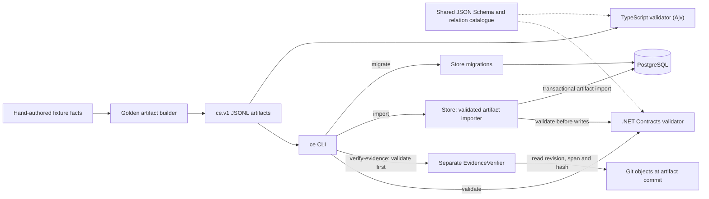
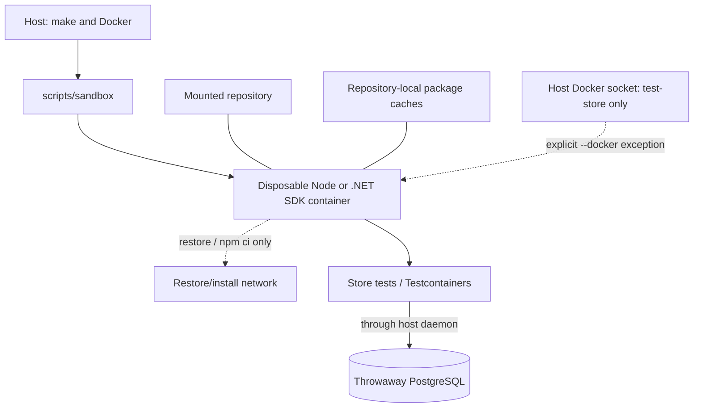

# Current system: contract, fixtures and import

**Basis:** inspected local stage-1 source at
`ae9bac966037a5348027c2b2d3e0201a430bf09c`, documented 2026-11-04.
This is a static source view, not a deployment verification. Documentation
changes do not change the depicted product behavior.

All implementing links below are pinned to this historical source, not the
newer publication branch. This view must be reconciled before being used as
an architecture claim about newer main.

## Component and artifact flow

Arrows show source-observed calls or data flow; dashed arrows indicate contract
dependency. CLI validation, evidence verification and import are **separate
commands**. Import validates the contract but does not invoke source-evidence
verification. No general source extractor, HTTP API, Explorer UI, inference
engine, vector index or cross-repository resolver is implemented in this
checkout. Fixture variety is not evidence that these capabilities exist.

| Responsibility | Implementing source |
|---|---|
| Record shape and relation constraints | [schema](https://github.com/Sonberg/capability-explorer/blob/ae9bac966037a5348027c2b2d3e0201a430bf09c/schema/v1/record.schema.json), [relations](https://github.com/Sonberg/capability-explorer/blob/ae9bac966037a5348027c2b2d3e0201a430bf09c/schema/v1/relations.json), [contract rules](https://github.com/Sonberg/capability-explorer/blob/ae9bac966037a5348027c2b2d3e0201a430bf09c/schema/README.md) |
| Golden artifacts from fixture facts | [builder](https://github.com/Sonberg/capability-explorer/blob/ae9bac966037a5348027c2b2d3e0201a430bf09c/fixtures/golden/build.mjs), [fixture guide](https://github.com/Sonberg/capability-explorer/blob/ae9bac966037a5348027c2b2d3e0201a430bf09c/fixtures/README.md) |
| Command dispatch and database connection selection | [CLI Program.cs](https://github.com/Sonberg/capability-explorer/blob/ae9bac966037a5348027c2b2d3e0201a430bf09c/platform/src/CapabilityExplorer.Cli/Program.cs), `validate`, `verify-evidence`, `migrate`, `import` |
| Framing, IDs, foreign keys, coverage and relations | [ArtifactValidator.Validate](https://github.com/Sonberg/capability-explorer/blob/ae9bac966037a5348027c2b2d3e0201a430bf09c/platform/src/CapabilityExplorer.Contracts/ArtifactValidator.cs) |
| Revision, source span and snippet-hash checks | [EvidenceVerifier.VerifyAsync](https://github.com/Sonberg/capability-explorer/blob/ae9bac966037a5348027c2b2d3e0201a430bf09c/platform/src/CapabilityExplorer.Contracts/EvidenceVerifier.cs) |
| Schema-backed TypeScript contract checks | [TS package](https://github.com/Sonberg/capability-explorer/blob/ae9bac966037a5348027c2b2d3e0201a430bf09c/extractors/ts/package.json), [TS validator source](https://github.com/Sonberg/capability-explorer/tree/ae9bac966037a5348027c2b2d3e0201a430bf09c/extractors/ts/src) |
| Atomic import and duplicate/conflicting-content handling | [ArtifactImporter.ImportAsync](https://github.com/Sonberg/capability-explorer/blob/ae9bac966037a5348027c2b2d3e0201a430bf09c/platform/src/CapabilityExplorer.Store/ArtifactImporter.cs) |
| Database schema changes | [Migrator](https://github.com/Sonberg/capability-explorer/blob/ae9bac966037a5348027c2b2d3e0201a430bf09c/platform/src/CapabilityExplorer.Store/Migrator.cs) |

The importer identifies an analysis by repository, commit, unit, extractor
identity/version and configuration. Identical content under that key is a
no-op; different content is rejected rather than overwritten. These are source
observations, not a new successful concurrency-test claim.

## Build and test boundaries

The [pinned Makefile](https://github.com/Sonberg/capability-explorer/blob/ae9bac966037a5348027c2b2d3e0201a430bf09c/Makefile) routes product build/test/install steps through
[scripts/sandbox](https://github.com/Sonberg/capability-explorer/blob/ae9bac966037a5348027c2b2d3e0201a430bf09c/scripts/sandbox). The documented sandbox uses a
non-root user, read-only root filesystem, dropped capabilities, an environment
allowlist and offline build/test steps after restore. The Docker socket
exception used by `test-store` grants host-daemon control; it is not suitable
for untrusted analysis/extraction. This diagram expresses the configured
workflow, not a sandbox penetration test.

## Change checklist

Update this view with changes to CLI commands, validation/evidence separation,
artifact identity/contract, import behavior, persistence, runtime boundaries
or build/test isolation. New extractors, API/UI components, binding, inference
or indexes must be drawn only when implemented in the source being documented.
Keep uncertainties and target proposals in the [wiki](../wiki/index.md),
linked from here where relevant.
