# Current model-evidence architecture

This scoped source view describes the model path, not the complete system or a
production deployment. Basis: model commits `b9d4dc6`, `603b95c` and `c1ddaf8`
on the `734ba5f` main baseline, refined by `8795fe7` (QName resolution).
Keep this diagram aligned when this flow changes.

```mermaid
flowchart LR
    XML["Authored BPMN / DMN bytes"]
    Guard["Bounded XML parser and qualified construct census"]
    Evidence["ce.models.v1: typed elements, references, raw text, diagnostics"]
    Original["ce.model-source.v1: opt-in exact original bytes"]
    Seal["Collection exporter: hash, permission and crosslink validation"]
    Stage["Bounded staging and independent verification"]
    Collection["Immutable ce.collection.v1"]
    Attempt["Separate attempt identity / observation metadata"]
    TS["Independent TypeScript consumer"]
    NET["Independent .NET consumer"]
    Store["File / PostgreSQL model queries"]
    UI["Read-only tables, provenance and grouped diagnostics"]
    Frame["Isolated viewer: verified original XML"]

    XML --> Guard --> Evidence
    XML -->|"explicit model-content permission"| Original
    Evidence --> Seal
    Original --> Seal
    Seal -->|"required validation succeeds; optional failures stay partial"| Stage
    Stage -->|"atomic rename; refuse conflicting target"| Collection
    Seal --> Attempt
    Collection --> TS
    Collection --> NET --> Store --> UI
    Store -->|"independently verified source attachment"| Frame
```

The parser recognizes exact standard namespaces; vendor/lookalike namespaces
cannot become core flow facts. Censused layout is structurally retained, not
semantic or visual conformance validation. Incoming/outgoing declarations check
existing sequence-flow endpoints. Allowed-value text stays raw and requires
content opt-in. The UI uses existing typed records; no profile-shape migration
or FEEL/process execution is introduced.

Rendering uses the separately verified original attachment, not reconstruction
from extracted semantic coverage. A successful diagram import does not prove
complete extraction. Partial/unsupported evidence remains explicit.

Source anchors: [`extract.ts`](../../extractors/ts/src/models/extract.ts),
[`construct census`](../../schema/models/support.json),
[`collection contracts`](../../platform/src/CapabilityExplorer.Contracts/Collection),
[`model API`](../../platform/src/CapabilityExplorer.Explorer/ModelApi.cs),
[`model UI`](../../platform/src/CapabilityExplorer.Explorer/client/src/views/ModelEvidence.tsx).

Repository evidence can feed aligned architectural and business viewpoints at
higher levels; accepted semantics, aggregation/ownership decisions and
stakeholder products remain downstream under #33. This flow establishes no
enterprise hierarchy or inferred business approval.

The #33 acceptance follow-up exercises the existing collection boundary, not a
new service. Content identity excludes attempt metadata; changing an attempt is
not changing immutable evidence. Required failures do not produce a completed
bundle; optional omissions remain explicit. A pre-cancelled export test does
not establish arbitrary crash/interruption recovery or authenticated publication.
See the [acceptance record](../plans/collector-handoff-acceptance.md).
