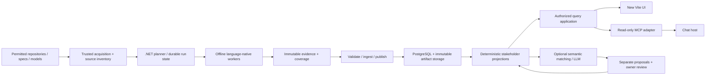

# Congratulations, We Almost Built a Distributed Monolith

## A hindsight architecture report: fewer runtimes to operate, better evidence to trust

Date: 2026-11-05. Status: **council evaluation and proposed direction**, not an
accepted replacement architecture, implementation plan authorization or benchmark.
Baseline: `bf4f089a34d93f79babd26f4f5be21e1b7884ae7`.
The title roasts our temptation to solve boundaries with more services, not the
contributors. It does not claim that a deployed distributed monolith was measured.

## 1. The answer we should have started with

Build an **evidence product with language-native collectors**, not a universal
parser, an all-knowing graph or a fleet of language-specific web services.

Keep .NET for the trusted control plane, ingestion and query application.
Run extraction in separate, bounded, offline worker processes using the best
qualified frontend for each language. Start with one common evidence contract,
one ingestion path and one stakeholder-oriented query API. Separate modules
before separating network services. Separate trust boundaries even when the
code uses the same language.

Do not rewrite the scheduler in Go or Elixir merely because extraction is slow.
Measure stages, remove repeated work, improve discovery and bound concurrency.
Use performance objectives to choose experiments, not to promise that a runtime
change will make compiler work cheap.

Build the requested **new Vite UI**, without porting the old UI. Keep the existing
UI usable during transition. Put a bounded MCP adapter over the same authorized
query application used by the UI. Deterministic evidence comes first; semantic
matching and LLM explanation create separate, reviewable proposals.

### Direct decisions

| Question | Recommended starting point | Revisit when |
|---|---|---|
| All analysis in .NET? | No. .NET owns coordination and shared evidence logic; native frontends own language semantics. | A frontend alternative beats the existing one on supported semantics, evidence fidelity and complete operating cost. |
| One host and one analyzer? | Separate web/query host from the privileged acquisition/worker host. The worker host dispatches isolated children, not one giant analyzer. | Independent scaling, trust or ownership requires another deployment boundary. |
| One reader per language? | One source inventory, adapter protocol and ingestion application; multiple qualified language adapters. | A particular adapter needs separate capacity or release cadence, not merely a different syntax. |
| Go or Elixir for concurrency? | Neither by default. Existing .NET code already dispatches concurrent work. | Source-bound profiling shows orchestration, rather than compiler CPU, memory, I/O or startup, is the limiting stage. |
| Can SLOs force speed? | They make a gap and its cost visible. Algorithms, caching, scheduling and capacity must close it. | An experiment demonstrates improvement without reducing coverage or hiding errors. |
| Laya for connections and terms? | Evaluate behind a replaceable proposal interface; never make a score the authority for identity or a deployed connection. | Its pinned implementation passes the task-specific evaluation and licensing/data-handling review. |
| Merge terms on change? | Version observations and propose consolidation; preserve distinct meanings and review history. | An explicit, authorized semantic decision permits a particular merge. |

## 2. What the current project already got right

The current system is not starting from zero:

- `ce.v1` already separates analysis identity, evidence, coverage and resolution.
  Line numbers are not symbol identity, and truncated artifacts are rejected [R1].
- The CLI already separates acquisition, offline extraction, validation,
  publication and optional enrichment. Its source/package acquisition gates are
  serialized, while capability and extraction work are bounded concurrently [R2].
- Import is language-neutral and transactional per artifact. Same analysis key
  with different content is an error, not an overwrite [R3].
- Deterministic glossary grouping and model-produced proposals already have
  different implementations and authority. Preserve that distinction [R4].
- Authored BPMN/DMN, code candidates and collection transport already have
  distinct profiles and stated limits. Rendering a model does not approve it [R5].

The bigger hindsight mistake would be to discard these contracts while replacing
the screen. The current client already uses Vite; the request is a **new product
experience**, not the discovery that Vite can build a frontend [R6].

There are also reasons to improve the seams. Adapter availability is currently
inferred partly by reading CLI source for command strings. Every discovered
language job is paired with repositories before unit-level applicability is
known. Replace this with explicit manifests and a coverage-aware planner, not
another language-specific HTTP endpoint [R2].

Acquisition uncertainty and incomplete termination confirmation can block later
work. This is a recovery/correctness problem, not evidence that .NET concurrency
is inadequate. A faster parser cannot repair an unreconciled publication [R2,R7].
No representative stage profile or cross-runtime benchmark was run for this report.

## 3. The boundaries we would draw on day one

These are responsibilities, not eleven independently deployed microservices.
Initially use a modular .NET core, a query host, a worker host, isolated extractor
children, static web assets and PostgreSQL. The optional semantic worker can use
its upstream runtime without forcing that runtime into the core.

| Boundary | Owns | Must not own |
|---|---|---|
| Acquisition and inventory | Credentials, commit resolution, safe export, dependency receipts, permitted content and filesystem checks. | Business interpretation or execution of target applications. |
| Planning and execution | Frozen input vector, eligible units, budgets, cancellation, attempts, progress and recovery. | Silent retries of uncertain work or permission inferred from a queue entry. |
| Language adapters | Static observations, exact source mappings, supported-feature census and diagnostics. | Cross-repository deployment guesses or approved domain meaning. |
| Ingestion and publication | Contract validation, idempotency, immutable evidence and atomic published selections. | Compiler-specific parsing or LLM-generated extractor facts. |
| Deterministic projections | Contract candidates, clusters, comparisons, explainable relevance and read indexes. | Destructive consolidation of distinct source observations. |
| Interpretation and review | Grounded explanations, tentative mappings, decisions, authorship and versioned review. | Rewriting immutable facts or self-approving a business definition. |
| Query application and MCP | Scoped retrieval, bounded graph traversal, evidence and freshness. | Repository credentials, arbitrary SQL, arbitrary shell or automatic source writes. |
| New web UI | Role-specific tasks, progressive detail, accessible navigation and visible uncertainty. | Being the only place where domain rules or authorization exist. |

**Ingestion is not reading.** Use separate command/write and query interfaces,
even if they share assemblies and PostgreSQL initially. Large imports must not
load compiler state into the web process or block interactive queries. Give
published queries bounded pagination, timeouts and projections. A language field
is evidence metadata, not a reason to run another database or query service.

Retain the current single-host journal where it is qualified. A later distributed
scheduler needs durable job identity, publication fencing, idempotent handlers
and tested recovery; a broker alone supplies none of these. Do not prescribe
Kafka, Redis, Kubernetes or Elixir supervision before there is an operating need.
The current localhost request guard is not an internet identity/authorization
system. Remote hosting requires a separate reviewed authentication, source-rights
and tenancy design [R8].

An ideal repository would group `apps/web`, `apps/query`, `apps/worker-host`,
`modules/evidence`, `modules/projections`, `frontends/<language>`, shared
`contracts` and independent `tests/oracles`. These are illustrative boundaries,
not instructions to rename the existing tree or split Git repositories.

## 4. Language choices by use case

Choose a language for its ecosystem and semantic access, not for a concurrency
reputation. The following are frontend candidates, not claimed implemented support.

| Work | Preferred starting point | Important limit |
|---|---|---|
| Control plane, ingestion, publication, read API and MCP application adapter | C# / .NET, reusing current typed contracts and tests. | Separate privileges and processes; a common language is not isolation. |
| C# and .NET semantics | Roslyn in a .NET worker. | Resolve permitted references without running target builds, generators or application code. |
| JavaScript / TypeScript | TypeScript compiler APIs in a Node/TypeScript worker. | Dynamic loading, bundlers and runtime configuration can leave targets unresolved. |
| Python | Python AST first; qualify a resolver/type-analysis layer when needed. | Do not import analyzed modules. Reflection and dynamic dispatch remain partial. |
| Java / JVM | Qualified Javac/JDT-style frontend in a JVM worker. | Do not run Maven/Gradle builds or annotation processors from target source. Bytecode-only evidence has different provenance. |
| Go | Go AST/types tooling in a Go worker. | Package discovery must not silently download dependencies or run target generators/cgo. |
| Rust | Sealed SCIP or syntax inventory first; assess rust-analyzer/compiler-oriented tooling when demand requires. | Qualify index provenance and semantic coverage. Proc macros/build scripts can execute code; disable them or qualify a separately authorized profile and report omissions. |
| SQL | Dialect-specific static adapters; retain the current TypeScript parser until a measured fidelity gap justifies replacement. | T-SQL, PostgreSQL and other dialects are not interchangeable. No live database execution. |
| Common relation rules, hashing, clustering and stakeholder projections | Keep shared deterministic logic in .NET initially. | Version normalization, input ordering, configuration and tie-breaking rules. |
| Laya and model enrichment | Evaluate its .NET ONNX port for the bounded classifier; use another runtime only where the required qualified mode needs it. | Port parity is not application accuracy or generative-mode parity. Enrichment must not be required for core publication. |
| New web UI | TypeScript with Vite and the chosen UI framework. | Browser code does not become an analysis worker or receive private acquisition credentials. |

Do not build universal compiler semantics in C# merely to have one language.
Equally, do not add Python, Go, Rust and JVM services before demand is known.
Admit one adapter at a time through the same artifact/coverage conformance suite.
A fast syntax tree can support navigation; it must not masquerade as resolved
type, call or integration analysis.
Adapter envelopes, discovery manifests and embedded-source mappings are future
contracts requiring compatibility review. Do not silently add record kinds or
authority to the existing closed `ce.v1` contract.

### One repository can contain several languages

Discovery must return analysis units, dependency edges and unsupported inventory,
not assign one language to a repository. A .NET server can serve JS files; that
does not make the JS C#. A Go service can embed SQL; that does not make the SQL Go.

For SQL in C#: retain the host-language callsite and a source map from a proven
constant string to its SQL fragment, identify the dialect from evidence, then
send the fragment to the SQL adapter. Preserve concatenation/interpolation gaps,
parameter bindings and source spans. Dynamic text stays partial; never execute
it to discover meaning. The current C# rules already recover some constant SQL
and table relations, but regex table matching is not full SQL semantics [R9].

For inline JS/templates and generated source, use the same host-to-embedded
mapping contract. Preserve escaping, offsets, encoding and macro/generated
provenance. Attach a composed relation only where both analyses justify it.
Deduplicate overlapping observations without dropping either source receipt.
An unsupported or unmapped fragment must remain visible in coverage.

## 5. Concurrency: measure the work, not the language's reputation

At this baseline, capability workers and extraction jobs each have a 1..4 bound,
with a combined ceiling of 16. Children have isolated output paths; source and
package acquisition have separate shared gates [R2]. Thus "we need Go to get
parallel extraction" starts from a false premise.

The optimization order should be:

1. Instrument queue, fetch/export, dependency acquisition, discovery, parsing,
   semantic analysis, serialization, validation/import, projection and enrichment.
2. Freeze the same repositories, revisions, toolchains, dependency cache, rights
   and hardware. Report cold and warm runs separately, plus errors and omissions.
3. Skip inapplicable adapters, reuse qualified unchanged units, reduce repeated
   enumeration/compiler startup and profile allocation/serialization/query costs.
4. Schedule by unit cost, available memory and CPU, with one global budget across
   capabilities and compiler-internal parallelism. Async I/O is not CPU capacity.
5. Compare a source-bound candidate to the baseline. Change algorithms or a proven
   hot component before changing the orchestration language.

Go is credible if a small, well-defined coordinator has measured allocation or
deployment advantages. Elixir is credible for a genuinely distributed,
message-heavy operational control plane with team expertise. Neither makes
Roslyn, JVM resolution or SQL analysis intrinsically faster. Another runtime
adds packaging, failure diagnosis, protocol and ownership costs.

### Proposed performance experiment, not measured compliance

| Proposed objective | Measurement contract |
|---|---|
| Admission/status p95 <= 250 ms | Ten concurrent clients; excludes execution, includes authorization; record queue depth. |
| Bounded read API p95 <= 500 ms | Fixed published 100k-node snapshot, page <= 100, ten concurrent readers, warm database. |
| Warm extraction p95 <= 75% of the recorded baseline | Fixed mixed-language corpus, e.g. 100k source lines/20 units, 8 vCPU/16 GiB, unchanged dependencies; total extraction wall time, not one parser microbenchmark. |
| Warm end-to-end p95 <= 80% of the recorded baseline | Same admitted scope to published core snapshot; measure queue and every stage, excluding optional enrichment only if separately reported. |
| Optional semantic work never blocks core publication | Model disabled, timeout and quota-exhaustion tests still leave a queryable core snapshot with explicit enrichment status. |

These numbers are discussion targets to calibrate after baseline measurement,
not adopted SLOs, existing results or a relaxation of stronger existing targets.
Use at least 30 runs for an initial screening distribution and publish raw samples,
tail uncertainty, peak RSS, CPU time, cache hit rate and model cost. Do not sum
stage p95s and call that end-to-end p95. Count failed/time-limited runs separately
and include success rate so faster failures cannot improve the headline.
Require unchanged evidence/coverage and protected oracle quality before accepting
a speed gain. Stop starting jobs on dependent failure; preserve uncertain state.

## 6. Cross-repository connections: evidence before resemblance

Extract **both sides**: provided HTTP operations and consumer requests, published
messages and subscriptions, schema versions and payload envelopes. Preserve
repository/revision, operation, direction, protocol, route/channel, requiredness,
nullability, errors, authorization expectations and source evidence.

First create deterministic candidates using explicit configuration and contract
identities. Check compatibility directionally: a producer can emit values a
consumer cannot accept; identical field names do not prove compatible meaning.
Required fields, enum expansion, units, formats, envelopes, protocol version and
error behavior all matter. Record unknowns where static code cannot establish them.

Only then use semantic matching for unresolved names or shapes. Keep separate:
**structural compatibility**, **semantic correspondence**, **configured binding**
and **observed runtime communication**. None automatically proves the next.
Similar endpoints in different environments must not become one system edge.

### Laya: useful candidate, wrong job description

The adversary inspected `NandhaKishorM/laya` at
`5a6dc4b809659dab3b9b3062f5e3902db983818a` (2026-11-05). It supplies typed
text decisions: closed choices, ordered scores and boolean probabilities.
It is **not a turnkey OpenAPI/AsyncAPI compatibility or business-identity engine**.
Its shortlist uses a caller-supplied embedder; that is not a built-in clustering
or contract-equivalence algorithm [E1,E2].

Feed it bounded, evidence-derived descriptions and declared relation labels,
including an insufficient-evidence outcome. Our application still owns contract
parsing, direction/version rules, source citations, abstention and review.
The structured schema restricts output questions, not input state: serialized
contract text can be classified, but no contract validation follows [E1].

The Python constructor defaults to the classifier; `vegaml=True` is opt-in,
although its package dependency is mandatory. The .NET port's parity tests cover
classifier modes, not that generative path. Qualify costs per mode. Code is Apache-2.0;
verify checkpoint, dependency and optional-model licenses separately. Pin code,
weights, tokenizer, runtime and model recipe; no runtime downloads in offline
analysis. A port can avoid a new Python service but still needs evaluation [E1,E3].

Proposed screening: at least 100 independently labeled, stratified cases covering
synonyms, identical names with different meanings, version changes and reversed
producer/consumer direction. Compare deterministic constraints alone against
constraints plus Laya; evaluate business-term and contract tasks separately.
Predeclare match precision >= .98, negative-case false-positive rate <= .02 and
recall >= .90 as provisional targets. Report abstention, uncertainty intervals,
wording sensitivity, cold/warm latency, RSS and total cost. Seek improved recall
at fixed precision; do not demand a precision gain above a 100% baseline.
This small test screens a hypothesis, not production accuracy. No score permits
automatic merges, and passing these targets does not override schema constraints.
If it adds no task benefit, keep deterministic matching and leave Laya disabled.

## 7. Business terms: relevance is not the same as similarity

The deterministic layer should extract source occurrences, roles, contract and
calculation participation, scoped names, documentation and evidence. Group only
under explicit, versioned rules. Preserve domain/context boundaries and stable
tie-breaking. A deterministic cluster is reproducible, not necessarily correct.

Then let an LLM explain a bounded cluster and suggest names, definitions,
ambiguities and relationships, citing supplied evidence. Do not let it invent
facts needed to make the cluster look coherent. The existing glossary service
already models this as a separate proposal [R4].

For "core terms", rank by an explainable, versioned rubric: stakeholder decision
relevance, domain ownership, contract participation, important rules/calculations,
cross-context use and persistence where appropriate. Penalize framework plumbing,
generated transport wrappers and generic labels. Frequency or graph centrality
alone can make `Id`, `String` or a utility class look important.

Show the features, coverage and context behind each ranking. A presentation tier
named "core" is not a DDD core domain or an approved business definition. Owners
must validate meaning and priority. Evaluate term relevance with representative
business tasks and engineering tasks, not just a global embedding score.

Use semantic matching to propose `same-as`, `related-to`, `broader-than` or
`conflicts-with` only under an explicitly qualified relation profile. Similar
labels across contexts may have different cardinalities, units or lifecycles.
Do not collapse them transitively because A resembles B and B resembles C.

## 8. Deltas: hash records, not our hopes

Use SHA-256 at several distinct layers. A database row number or source line is
not semantic identity. A Git commit hash is not an analysis-input fingerprint.

| Identity | Proposed job |
|---|---|
| Source tree/file digest | Detect changed bytes, including permitted untracked inputs in an immutable snapshot. |
| Analysis-input fingerprint | Source/dependency digests + frontend/rules/config/schema versions + relevant platform inputs and permissions. |
| Record content digest | Hash canonical record semantics with a declared recipe, excluding volatile ingestion IDs/times and separating evidence locations. |
| Occurrence identity | Attach a record observation to its repository/revision/artifact. Never reuse an old commit citation as new evidence. |
| Proposal identity | Qualified deterministic inputs + model/embedding/provider recipe + prompt/schema + scope/rights and thresholds. |
| Reviewed concept identity | Governed identity and versioned decisions, not the latest cluster label or row offset. |

Keep raw evidence hashes distinct from normalized semantic fingerprints. A moved
line can leave meaning unchanged while changing evidence spans. The current
`irHash` already has narrower semantics than whole-artifact or runtime equality
[R1]. Any new digest recipe needs a versioned contract and migration review.

The incremental pipeline should: freeze an input vector; compare manifests;
invalidate changed units plus dependency-sensitive dependents; re-extract;
validate and diff added/changed/removed records; rebuild affected projections;
then queue only affected semantic proposals. Use `git log`/diff for provenance
and change explanation, not proof of meaning or runtime effect.

Handle branch switches, force-pushes, merges, renames, deleted files, dependency
and toolchain changes. Missing observations under partial coverage are not
deletions. Reuse unchanged semantic work only after revalidating its input and
permissions; publish new occurrence/evidence bindings for the selected revision.
Periodically compare incremental output with an independently run full rebuild;
changes outside a naive Git file diff must not produce silently stale results.

Debounce related changes and bound model spend. Pin model identity where possible;
retain exact requests, outputs and recipe metadata rather than promising bitwise
LLM determinism. A model change can invalidate proposals without rerunning the
compiler. A rejected or reviewed definition cannot silently become an unreviewed
replacement. Consolidation is append-only, reversible and owner-reviewed.

## 9. Stakeholders need products, not a bigger graph

| Stakeholder | Questions and default view | Qualification that stays visible |
|---|---|---|
| Business | "What process or decision is this? What changed? Who owns its meaning?" Curated BPMN/DMN, concise documentation and evidence-linked chat. | Authored model vs code candidate, unknown roles/rules, effective scope, source revision and review. Code cannot establish the complete business process. |
| Engineering | "What implements this contract? What depends on this change? Which rule failed?" Application/service/system views, standards findings and source navigation. | Static target vs configured binding, supported language coverage, severity/rule version and suppressions. A style pass is not system correctness. |
| Architecture | "What is the current observed structure, across which boundaries, and how confident are we?" Scoped system/context views, contracts, drift and ownership gaps. | Selected source revisions and freshness, deployment evidence if available, proposed vs reviewed relations. Current source is not current production. |

Use one evidence model with different projections, not three competing truths or
separate graphs per persona. Start each view with a bounded question and scope;
offer counts, summaries and drilldown before raw nodes. Keep "why shown", evidence,
unknown coverage and last-good snapshot available.

BPMN and DMN need explicit supported profiles and human review. Do not translate
every call graph into a business process, every conditional into an approved
decision table, or every calculation into equivalent FEEL. Preserve operation
order, exceptional paths and unsupported constructs. Existing authored/code
profile boundaries remain in force [R5].

Task-based pilot measures should include whether each role finds the correct
source, distinguishes candidate from reviewed meaning and explains a change
without being shown the answer. Establish thresholds with actual stakeholders;
this report supplies no measured usability result.

## 10. The new website and MCP seam

Use Vite to develop/build the new UI; deploy built assets through a production
static host or reverse proxy. Vite's development/preview server is not the
production hosting strategy. Select a UI framework separately.

Interpret "always latest" as an explicit upgrade service: track the latest stable
Vite, open prompt upgrade changes, pin exact resolved versions and lockfiles,
run build/browser/accessibility/compatibility checks, then release with rollback.
If an upgrade is blocked, expose the exception and fix it. Do not resolve a
floating `latest` dependency during every build and call the result reproducible.

Build new role-specific screens against versioned APIs, not copied components or
the old UI's internal state. Reuse evidence contracts and useful behavioral tests,
not the old implementation. Keep the old UI until a new vertical slice qualifies;
do not combine frontend replacement with a simultaneous extraction rewrite.

The MCP shim should adapt typed query operations such as snapshot lookup, term
search, contract candidates, process/decision products and evidence retrieval.
Use the same application queries as HTTP, with explicit snapshot/scope and
bounded pages/depth. Do not expose unrestricted SQL, shell or source-file reads.

Authenticate the caller and authorize each operation before retrieval, clustering
or cached model input. Keep tenant/source-rights boundaries in indexes and caches.
Apply revocation and content minimization to derived text too. Repository text
is untrusted data, not instructions. Separate any future analysis/review/write
tool from read tools with its own authority and approval boundary.

Chat answers must cite permitted evidence and identify partial, stale, inferred
and unknown results. Model or semantic service failure must leave deterministic
navigation available. Neither MCP transport nor an LLM grants data access.

## 11. Enforce standards without confusing packages with governance

Introduce a root EditorConfig, scoped ESLint for JS/TS and .NET analyzer settings,
with CI checks that actually execute. The inspected baseline has no tracked
EditorConfig or ESLint configuration. Add language-native checks for future
Python, Java, Go and Rust adapters, rather than pretending ESLint covers them.
Stage new rules to avoid an unrelated mass reformat.
Formatting checks must fail on drift, ESLint on configured violations, and .NET
builds on selected analyzer errors. Version the rules, surface suppressions and
require reviewed exceptions; merely committing configuration is not enforcement.

A versioned NuGet analyzer/build package can require declared OpenAPI/AsyncAPI
artifacts, validate supported rules and validate synthetic examples in .NET
services. It cannot alone enforce Java, Python or Go repositories, nor prove
that a running provider or consumer obeys a specification.

Put reusable contract policy in language-neutral schemas/rules plus a CLI/CI
check; the NuGet package is the .NET integration. Provide equivalent integrations
where each language needs them. Lock package/tool versions and prevent arbitrary
remote schema fetches or untrusted target build execution during validation.

Require an explicitly versioned contract profile, ownership, examples, compatibility
policy and test evidence. Check examples against schemas; include error/event
cases and privacy-safe sample data. Test producer output and consumer acceptance
where execution is separately authorized. Design-only OpenAPI documents already
exist in `schema/openapi`; they are not organization-wide enforcement [R5].
Retain explicit exceptions for non-HTTP/non-event components and legacy adoption,
with an owner and review date, rather than fabricating empty specifications.

## 12. Delivery without the big-bang rewrite

| Stage | Smallest useful delivery | Gate before expansion |
|---|---|---|
| 0. Baseline | Inventory actual languages, stakeholder tasks, deployment constraints, source rights and stage timings. Preserve current UI and protected oracles. | Reproducible corpus, costs, unknowns and named owners; no unsupported language promise. |
| 1. Seams | Explicit adapter manifests, discovery/coverage and shared intake/query interfaces; isolate hosting from worker privileges. | Existing artifacts and query semantics unchanged; cancellation/recovery and denial tests. |
| 2. New UI + MCP | One new business process/decision slice and one engineering contract slice over the query API; read-only MCP. | Evidence/citation parity, real stakeholder tasks, access-control and browser checks. No old-UI port. |
| 3. Quality + throughput | Contract-policy CLI/.NET integration and one measured scheduler/cache optimization. | Negative contract examples, semantic goldens and source-bound performance comparison. |
| 4. Language breadth | Add the next demanded native adapter and one embedded-language mapping path. | Independent semantic oracle, coverage census, offline reproducibility and resource bounds. |
| 5. Semantics + deltas | Qualified Laya experiment, affected-cluster invalidation and reviewable term/connection proposals. | Deterministic comparator, false-positive review, traceable costs, rollback and governance. |

Stages can overlap only through explicit contracts and separate ownership.
Do not choose dates or a distributed deployment without team/corpus/scale data.
Preserve an escape hatch: disable semantic enrichment, roll back projections,
keep immutable evidence and route users to the last qualified UI/snapshot.

## 13. Council findings and evidence limits

Author/integrator: session `94729006`. Adviser `hindsight-adviser` supports a
common adapter boundary with native workers, not an all-.NET parser or a service
per language. Existing language-neutral research is proposed, not implemented
discovery or complete dependency invalidation [R10]. The report retains existing
protected quality gates rather than adopting the adviser's lower example targets.
Adversary `hindsight-adversary` rejects Laya as contract/identity authority but
allows a measured, optional proposal role. The author corrected output-schema
versus input-text reasoning and rejected transfer of unrelated classifier metrics.
Judge `hindsight-judge` declared completeness, evidence/status, alternatives,
performance, privacy and stakeholder-usefulness criteria before drafting.
Final judgment: the report meets those criteria, with no material omission or
error requiring revision. Reviewed report SHA-256:
`6a18fcd5ee9586ab4e2867360f85c07f77d2d48768ab37b42572c20f6beba384`.
This verdict assesses report quality only, not architecture adoption,
implementation authority or benchmarked performance. Shared model lineage and
source selection limit independence. This receipt was appended after review;
the substantive recommendations were not changed.

BA, EA and SA retained knowledge was consulted as contextual input. Retrieval was
bounded and parts were degraded or off-topic; it does not establish language
performance, adoption or implementation. No private source content, corporate
identifiers, source URLs or organizational examples are reproduced as report
evidence. The public/project sources below carry the inspectable claims.

Open decisions: actual corpus/language priority; deployment/tenancy requirements;
hardware and cost budget; semantic data permissions; contract policy ownership;
new UI framework; stakeholder relevance criteria; and acceptable operational SLOs.
These need measured evidence and accountable owners, not another runtime vote.

## Sources

Repository sources are at the baseline above. Proposed ADRs remain proposed.
Line ranges identify the inspected supporting sections, not whole-file certification.

| ID | Source and support |
|---|---|
| R1 | [Extractor contract](../../schema/README.md), lines 5-44 and identity/hash sections; [shared glossary](../ubiquitous-language.md), lines 9-115: evidence, revisions, coverage, lineage and authority. |
| R2 | [AnalysisPreparation](../../platform/src/CapabilityExplorer.Cli/AnalysisPreparation.cs), lines 13-27, 38-170; [parallel extraction](../../platform/src/CapabilityExplorer.Cli/AnalysisParallelExtraction.cs), lines 13-88; [capability scheduler](../../platform/src/CapabilityExplorer.Cli/AnalysisCapabilityScheduler.cs), lines 7-68: gates, bounds, job construction and attempt-owned output. |
| R3 | [ArtifactImporter](../../platform/src/CapabilityExplorer.Store/ArtifactImporter.cs), lines 24-116; [publication](../../platform/src/CapabilityExplorer.Cli/AnalysisPublication.cs), lines 13-112; [ImportCommand](../../platform/src/CapabilityExplorer.Cli/ImportCommand.cs), lines 16-150: validation, immutable identity and guarded publication. |
| R4 | [GlossaryConcepts](../../platform/src/CapabilityExplorer.Explorer/GlossaryConcepts.cs), lines 8-165; [GlossaryService](../../platform/src/CapabilityExplorer.Interpretation/GlossaryService.cs), lines 25-97; [ExplanationService](../../platform/src/CapabilityExplorer.Interpretation/ExplanationService.cs), lines 10-98: deterministic grouping and separate cited model proposals. |
| R5 | [MADR-0033](../adr/0033-bounded-model-and-collector-evidence.md), lines 19-90; [OpenAPI profiles](../../schema/openapi/): separate authored/candidate/collection profiles, fidelity and proposed design-only transport. |
| R6 | [Client manifest](../../platform/src/CapabilityExplorer.Explorer/client/package.json), scripts and exact Vite dependency: existing Vite client; not permission to port it. |
| R7 | [AnalysisProcess](../../platform/src/CapabilityExplorer.Cli/AnalysisProcess.cs), lines 12-29 and 99-139; [handoff](../HANDOFF.md), local-analysis section: uncertainty/recovery constraints, not a performance benchmark. |
| R8 | [Explorer host](../../platform/src/CapabilityExplorer.Explorer/Program.cs), lines 10-125; [MADR-0023](../adr/0023-host-acquisition-boundary.md), lines 9-67; [PostgresExplorerQueries](../../platform/src/CapabilityExplorer.Explorer/PostgresExplorerQueries.cs), lines 8-89: local hosting, acquisition separation and revision-scoped reads. |
| R9 | [C# rules](../../platform/src/CapabilityExplorer.Extractors.CSharp/Rules.cs), lines 747-789; [SQL extractor](../../extractors/ts/src/sql/extractor.ts), lines 11-68: constant-SQL table rules and dialect-qualified static SQL with dynamic coverage diagnostics. |
| R10 | [MADR-0025](../adr/0025-language-neutral-frontends-and-discovery.md), lines 33-77; [frontend research](language-neutral-frontends.md), lines 47-80, 133-150; [pseudocode](language-neutral-frontends-pseudocode.md), lines 15-27, 63-69: proposed adapters/coverage, not a discovery service or complete invalidation algorithm. [MADR-0035](../adr/0035-measurable-service-level-objectives.md), lines 34-68: measurable objectives, resource/failure envelopes and evidence. |
| E1 | [Pinned Laya README](https://github.com/NandhaKishorM/laya/blob/5a6dc4b809659dab3b9b3062f5e3902db983818a/README.md); [structured decisions](https://github.com/NandhaKishorM/laya/blob/5a6dc4b809659dab3b9b3062f5e3902db983818a/docs/structured.md), lines 1-70; [implementation](https://github.com/NandhaKishorM/laya/blob/5a6dc4b809659dab3b9b3062f5e3902db983818a/laya/structured.py), lines 193-251, 353-361: output questions are distinct from input state. Upstream capabilities, not this project's results. |
| E2 | [Laya shortlist implementation](https://github.com/NandhaKishorM/laya/blob/5a6dc4b809659dab3b9b3062f5e3902db983818a/laya/shortlist.py), opening documentation and embedder interface: caller-supplied vectors. |
| E3 | [Python manifest](https://github.com/NandhaKishorM/laya/blob/5a6dc4b809659dab3b9b3062f5e3902db983818a/pyproject.toml), lines 4-31; [constructor](https://github.com/NandhaKishorM/laya/blob/5a6dc4b809659dab3b9b3062f5e3902db983818a/laya/agent.py), lines 541-569; [.NET project](https://github.com/NandhaKishorM/laya/blob/5a6dc4b809659dab3b9b3062f5e3902db983818a/laya-dotnet/src/Laya/Laya.csproj) and [parity tests](https://github.com/NandhaKishorM/laya/blob/5a6dc4b809659dab3b9b3062f5e3902db983818a/laya-dotnet/tests/Laya.Tests/DifferentialParityTests.cs); [license](https://github.com/NandhaKishorM/laya/blob/5a6dc4b809659dab3b9b3062f5e3902db983818a/LICENSE): dependency, defaults, port scope and source license, not checkpoint clearance. |
| E4 | [TypeScript compiler API](https://github.com/microsoft/TypeScript/wiki/Using-the-Compiler-API); [Go container-aware parallelism](https://go.dev/blog/container-aware-gomaxprocs); [Rust compiler internals](https://rustc-dev-guide.rust-lang.org/rustc-driver/intro.html): ecosystem/toolchain choices, not comparative extraction benchmarks. |
| E5 | [Vite guide](https://vite.dev/guide/) and [production build](https://vite.dev/guide/build): development/build tooling and static deployment. The latest-stable/lockfile policy above is our proposal, not Vite's mandated policy. |
| E6 | [MCP authorization, 2025-06-18](https://modelcontextprotocol.io/specification/2025-06-18/basic/authorization): transport-specific authorization, not automatic data permission. [OpenAPI 3.1.1](https://spec.openapis.org/oas/v3.1.1.html) and [AsyncAPI 3.0.0](https://www.asyncapi.com/docs/reference/specification/v3.0.0): contract semantics, not chosen universal versions or proof of enforcement. |

No candidate tool was installed, run against private code or benchmarked.
